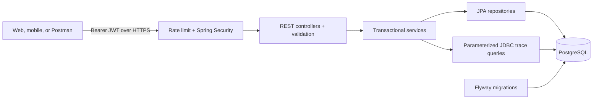

# Food Plant Traceability API

A Java 17 / Spring Boot REST backend for a fictional Jaipur frozen-food plant. It manages product lines, suppliers, batches, raw-material inventory and batch trace records. The `demo` profile loads **synthetic, non-production records**; no real production records were provided.

## Architecture



Controllers validate inputs and do not accept database entities as write bodies. Services enforce relationships, chronology and inventory availability; repositories handle the main CRUD entities. Flyway creates the schema. `docs/openapi.json` is generated from the running application and Swagger UI is at `/swagger-ui/index.html` (API spec `/v3/api-docs`).

## Data design

- `product_lines` and `suppliers` have surrogate IDs and unique codes. `batches` references a line and uses a surrogate ID as its canonical identity; `batch_number` is deliberately **not unique**. `numbering_epoch`, line and production date provide context when a system reset reuses a printed number. They do not prove two records are the same batch.
- `material_lots` references a supplier; `batch_materials` records consumption and connects lots to batches. Available kg is received kg minus recorded consumption. A transaction locks the lot before checking and recording consumption, preventing concurrent overspending on PostgreSQL. This model does not include returns, wastage, adjustments or unit conversion.
- `machines` belong to lines and `machine_runs` connect machines to batches on the same line. `quality_tests` preserve distinct sampling and recording timestamps. Nullable moisture means **not recorded**, not zero. A late result remains attached to the sampled batch; timestamps are UTC instants.
- Foreign keys restrict deletion of referenced records. The demo includes three lines, corresponding material, machine and quality records, `B-001` both before and after a reset, a result entered a day later, and a night-shift result without moisture.

## Start with Docker Compose

Requirements: Docker Compose v2. The compose file builds the application, starts PostgreSQL, waits for its readiness, runs migrations, and binds the API only to `127.0.0.1:8080`. Docker was unavailable in the development environment, so this path has **not been executed here**. Create your own secrets. Tests generate ephemeral credentials in memory; never use test credentials in production. The following PowerShell example uses Python and its separately installed `bcrypt` package to generate password hashes. Passwords should be distinct and no more than 72 UTF-8 bytes.

```powershell
$bytes = New-Object byte[] 32
[System.Security.Cryptography.RandomNumberGenerator]::Create().GetBytes($bytes)
$env:JWT_SECRET = [Convert]::ToBase64String($bytes)
$env:DB_PASSWORD = Read-Host 'Database password' # local demo; use a secret manager in deployment
$env:ADMIN_PASSWORD_HASH = python -c "import bcrypt,getpass; p=getpass.getpass('Admin password: ').encode(); assert 0 < len(p) <= 72; print(bcrypt.hashpw(p,bcrypt.gensalt()).decode())"
$env:STAFF_PASSWORD_HASH = python -c "import bcrypt,getpass; p=getpass.getpass('Staff password: ').encode(); assert 0 < len(p) <= 72; print(bcrypt.hashpw(p,bcrypt.gensalt()).decode())"
$env:USER_PASSWORD_HASH = python -c "import bcrypt,getpass; p=getpass.getpass('User password: ').encode(); assert 0 < len(p) <= 72; print(bcrypt.hashpw(p,bcrypt.gensalt()).decode())"
docker compose up --build
```

The compose default activates `demo`, which inserts synthetic records when missing at startup. Set `SPRING_PROFILES_ACTIVE=prod` before starting for an empty schema. Keep signing keys stable across restarts or outstanding tokens become invalid. Preserve the named PostgreSQL volume if data must persist. The compose example is for local development; it does not configure TLS or production secret management. Environment variables can be inspected by privileged local processes.

For a non-Docker run, start PostgreSQL separately and set `DB_URL`, `DB_USER`, `DB_PASSWORD`, and the four security variables above; run `./mvnw spring-boot:run` or `.\mvnw.cmd spring-boot:run`. Set `SPRING_PROFILES_ACTIVE=demo` for synthetic data. Maven dependencies require network access on the first build.

## Authentication and authorization

`POST /api/v1/auth/token` takes `{"username":"user","password":"..."}`. Fixed account names are `admin`, `staff`, and `user`; each configured BCrypt hash is verified without storing plaintext in the application database. The response includes an `accessToken`, `Bearer` type and 900-second expiry. Send `Authorization: Bearer <accessToken>` on API requests. JWTs are signed with HS256, with issuer, subject, role, issue and expiry claims; signatures, issuer and expiry are checked. No cookies or HTTP sessions are used. JWT claims are visible to the holder and must not contain sensitive information.

- USER, STAFF and ADMIN can read API records.
- STAFF and ADMIN can create and update.
- ADMIN alone can delete.
- Login and OpenAPI/Swagger documentation are public. Other unmatched routes are denied. Missing or invalid credentials return 401; an authenticated caller lacking the role gets 403.

Example local login and read in PowerShell; avoid exposing real passwords or tokens in history/logs:

```powershell
$secret = Read-Host 'User password' -AsSecureString
$plain = [System.Net.NetworkCredential]::new('', $secret).Password
$body = @{ username='user'; password=$plain } | ConvertTo-Json
$auth = Invoke-RestMethod -Method Post -Uri http://localhost:8080/api/v1/auth/token -ContentType 'application/json' -Body $body
$plain = $null; $body = $null
$h = @{ Authorization = "Bearer $($auth.accessToken)" }
Invoke-RestMethod -Uri 'http://localhost:8080/api/v1/batches?number=B-001&size=20' -Headers $h
Invoke-RestMethod -Uri http://localhost:8080/api/v1/batches/1/trace -Headers $h
```

## Endpoint guide

All paths start `/api/v1`. Collection endpoints use zero-based `page` and `size` (default 20, maximum 100). CRUD lists return `items`, `page`, `size`, `totalItems`, and `totalPages`; machine and inventory lists return arrays. Sorted by ID. Delete returns 204; referenced rows return 409 rather than cascading away traceability.

| Method | Path | Purpose |
|---|---|---|
| POST | `/auth/token` | Authenticate and obtain JWT |
| GET, POST | `/product-lines` | Search/list or create a line |
| GET, PUT, DELETE | `/product-lines/{id}` | Read, replace or delete a line |
| GET, POST | `/suppliers` | Search/list or create a supplier |
| GET, PUT, DELETE | `/suppliers/{id}` | Read, replace or delete a supplier |
| GET, POST | `/batches` | Filter/list or create a batch |
| GET, PUT, DELETE | `/batches/{id}` | Read, replace or delete a batch |
| GET | `/batches/{id}/trace` | Batch, material sources, machine runs and quality tests |
| GET, POST | `/inventory/material-lots` | Available quantities or record a receipt |
| GET | `/machines` | List machines |
| POST | `/batches/{id}/materials` | Consume a lot against a batch |
| POST | `/batches/{id}/quality-tests` | Append a quality result |
| POST | `/batches/{id}/machine-runs` | Append a machine run |

Product-line and supplier lists accept `search`. Batch lists accept `number` (case-insensitive substring), `lineId`, `status`, `from`, and `to` (inclusive ISO dates). Status is PENDING, HOLD, RELEASED or REJECTED; shift is DAY or NIGHT. See the generated OpenAPI schema for request fields and numeric constraints. IDs, rather than batch numbers, are used on trace endpoints. `docs/FoodPlant.postman_collection.json` contains all 23 operations: import it, set local environment `username` and `password`, run Login, and select requests deliberately. Do not share environments containing credentials or tokens.

## Tests and performance

Run `./mvnw clean verify` (Windows: `.\mvnw.cmd clean verify`); the verify phase enforces a 75% line-coverage gate. a generated JaCoCo report is at `target/site/jacoco/index.html`. Tests use H2 in PostgreSQL mode and the synthetic demo dataset, not the Compose PostgreSQL instance. To regenerate the checked-in specification: `./mvnw test -Dtest=OpenApiExportTest -DexportOpenApi=true`. `docs/TEST_REPORT.md` records the measured test and local HTTP load results, scope and limitations. The optional local HTTP load run is `./mvnw test -Dtest=LocalLoadTest -DrunLocalLoad=true`; it uses the test-only H2 database and embedded server. A separate k6 script is provided at `load/batches.js` for testing a deployed system: set `TOKEN` and optionally `BASE_URL` and run `k6 run load/batches.js`. It has not been executed here. Redis caching was not implemented.

## Security and production boundaries

Spring Security enforces deny-by-default, request validation and standard security headers. Rate limits are a bounded in-memory fixed window per socket peer: 10 login attempts/minute and 12,000 other requests/minute by default; excess requests return 429. Configure `RATE_LOGIN_PER_MINUTE` and `RATE_GENERAL_PER_MINUTE` for the environment. The limit is per instance, resets on restart, does not trust X-Forwarded-For, and is unsuitable as a distributed or proxy-aware abuse-control system; use a trusted gateway and shared limiter in production. A proxy that connects on behalf of clients will share one bucket.

CSRF is disabled because authentication uses explicitly supplied Authorization headers, not cookies or HTTP Basic; reassess before using browser-managed credentials. Spring Boot emits structured JSON console logs, and login/token objects redact their contents. Never enable request-body or Authorization header logging at a proxy. Error responses do not reveal stack traces, although server-side logs retain internal exceptions for diagnosis.

For deployment, require TLS including the proxy-to-app connection, secure database connections and backups, use a secrets manager, add distributed throttling and security audit logs, and use a real identity provider with user management, revocation and key rotation. All authenticated roles currently see all tenant data; there is no tenant or per-record authorization. Tokens cannot be individually revoked before expiry and role changes take effect on newly issued tokens. This demo has no refresh tokens, account recovery, malware scanning or full operational monitoring. The H2 and synthetic local test is not proof of PostgreSQL correctness, security certification, or production throughput. No penetration test was performed.
